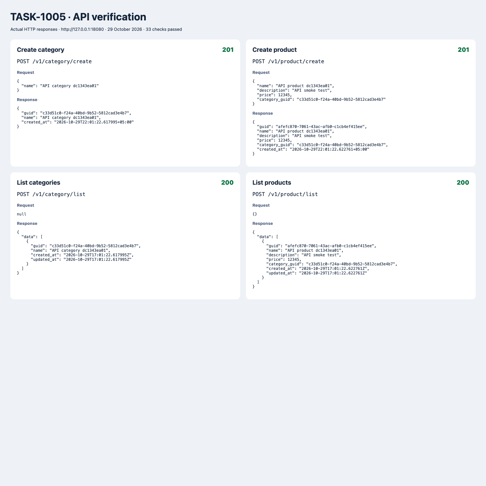
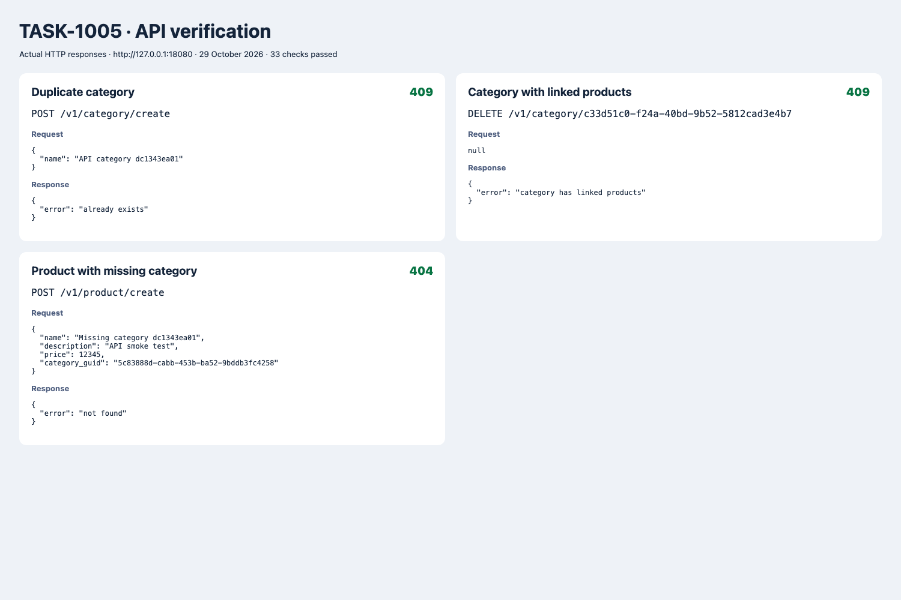

# TASK-1005: проверка API

Реализованы DTO, AppError, HTTP-хелперы, сервисы и хендлеры категорий/товаров, восемь маршрутов `/v1` и подключение слоёв в `main.go`.

## Запуск

```sh
docker compose up -d
go run main.go
```

Если порт 8080 занят:

```sh
APP_PROCESSOR_WEB_SERVER_LISTEN_PORT=18080 go run main.go
```

## Проверки

```sh
go test -race ./...
make lint
CATALOG_URL=http://127.0.0.1:18080 python3 scripts/test_api.py
```

Скрипт выполняет 33 HTTP-проверки, создаёт записи с уникальными именами и удаляет свои записи после проверки. По умолчанию использует порт 8080 и сохраняет реальные запросы/ответы в `/tmp/task-1005-api-results.json`; путь можно изменить через `API_REPORT`.

Проверены создание, оба списка, фильтр по категории, пустой массив, дубликаты при создании/обновлении, отсутствующие сущности, неверные параметры, частичный PATCH без цены, сохранение цены при нуле, запрет отрицательной цены, изменение описания и категории, запрет удаления категории с товарами и успешное удаление.

`price: 0` при PATCH означает «не менять цену». `description: null` или отсутствующее описание сохраняет прежнее значение; пустая строка устанавливает пустое описание. Это соответствует указательным/нулевым значениям DTO задания.

## Результаты запуска 29 октября 2026

- `go test -race ./...` — успешно.
- `make lint` — 0 issues.
- 33 HTTP-проверки — успешно, PostgreSQL 16, API на порту 18080.
- [Полные реальные запросы и ответы](api-results.json).

Ниже скриншоты отчёта, построенного из сохранённых HTTP-ответов (не скриншоты Postman).




