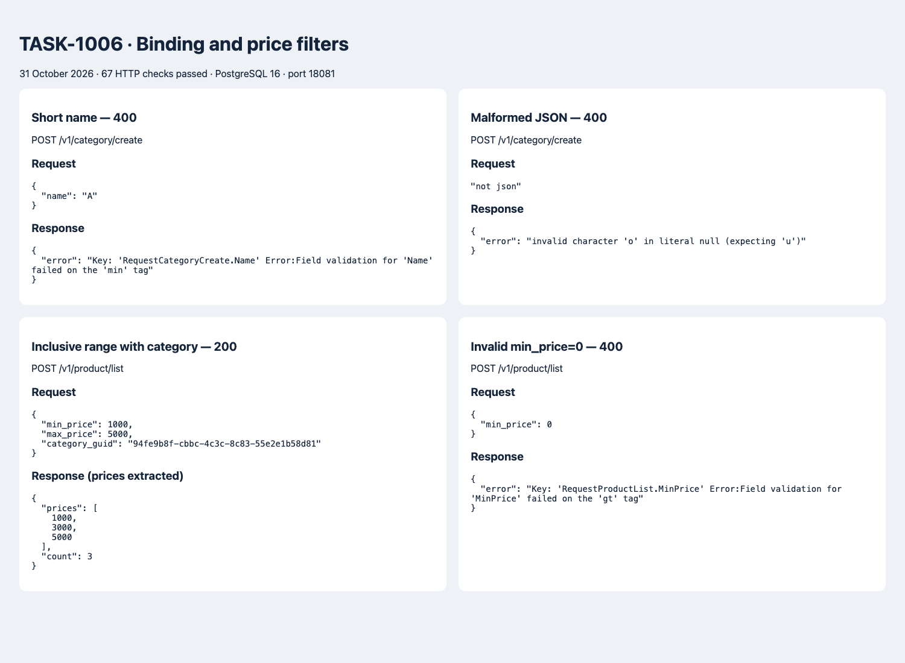

# TASK-1006: binding и фильтры цены

Добавлены DecodeJSON и пакет binding: JSON/query decoding, validator с тегом `binding`, безопасная инициализация через sync.Once, проверка структур и указателей через reflect. Ошибки парсинга и валидации возвращают HTTP 400 через общий HandleError.

Ручные Validate удалены. Имена при создании обязательны и имеют длину 2–255 символов; описание ограничено 1000 символами. Частичный PATCH сохраняет прежнюю семантику: отсутствующая/нулевая цена не меняет значение.

POST `/v1/product/list` принимает необязательные `category_guid`, `min_price`, `max_price`. Границы цены положительные, включительные и комбинируются через AND. Ноль отличается от отсутствующего значения благодаря *int64. Проверка min_price <= max_price по условию задания не добавлена: обратный диапазон возвращает пустой список.

Версии validator v10.27.0 и form v4.2.1 закреплены для сохранения Go 1.25 и совместимости с CI.

## Запуск и проверка

```sh
docker compose up -d
APP_PROCESSOR_WEB_SERVER_LISTEN_PORT=18081 go run main.go
CATALOG_URL=http://127.0.0.1:18081 python3 scripts/test_api_binding.py
go test -race ./...
go build ./...
make lint
```

JSON-фильтры передаются в теле, например `{"min_price":1000,"max_price":5000}`. Без фильтров отправьте `{}`. Query binding покрыт unit-тестами и доступен для будущих GET-обработчиков; новые HTTP-маршруты в этом задании не добавляются.

## Результаты 31 октября 2026

- 67 HTTP-проверок на PostgreSQL 16: успешно; созданные скриптом записи удалены.
- `go test -race ./...`, `go build ./...`, `make lint`: успешно.
- `go test -tags=integration -race ./...`: успешно с отдельной базой catalog_task1006_test.
- Тесты binding проверяют некорректный JSON, ограничения DTO, нулевые/отрицательные фильтры, query-параметры, nil, указатели и конкурентную инициализацию.
- [Полные реальные запросы и ответы](api-results.json).

Скриншот отчёта построен из реальных HTTP-ответов. Для диапазона цен показаны извлечённые цены и количество; полный JSON находится в файле выше.


