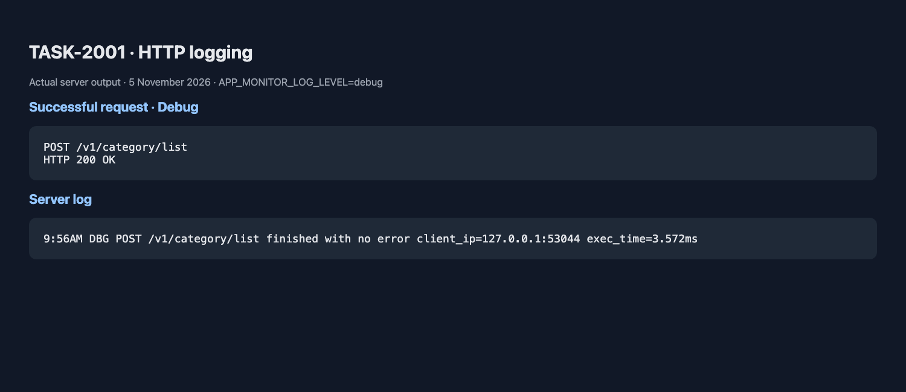
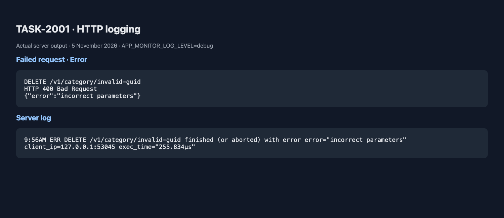

# TASK-2001: zerolog и HTTP-логирование

Добавлена двухэтапная инициализация через config.Load(LoadArgs): начальный Debug-логгер для загрузки конфигурации и итоговый логгер с APP_MONITOR_LOG_LEVEL. Поля JSON называются timestamp и msg; формат времени RFC3339. В main используется ConsoleWriter; для JSON передайте EnableSimpleLog: false. Output позволяет направить вывод в любой io.Writer, по умолчанию stdout. Неизвестный уровень завершает запуск с ошибкой.

Начальное сообщение `Logger initialized with Debug level` появляется даже при итоговом уровне info, поскольку создаётся до загрузки конфигурации. После переинициализации Debug-события подавляются.

## HTTP

Первый middleware создаёт отдельную ячейку ошибки/статуса в контексте каждого запроса. HandleError сохраняет исходную ошибку и HTTP-статус; ответ клиенту по-прежнему использует развёрнутую доменную ошибку. Второй middleware после обработчика пишет:

- Debug: METHOD URI finished with no error.
- Error: METHOD URI finished (or aborted) with error.
- Поля error, exec_time, client_ip; контекст передаётся событию через Ctx для будущих хуков.

Options WithLogger и WithSkipper позволяют заменить логгер и правило исключения. По заданию IsFilteredHttpRoute проверяет наличие health/debug/metric во всём RequestURI, включая query string. Исключение отключает только лог, не обработчик. Ошибкой считается значение, переданное через ErrorApply/HandleError; middleware не перехватывает panic и не определяет ошибки по одному WriteHeader. Контекстные значения используются синхронной цепочкой обработки запроса.

## Запуск и воспроизведение

```sh
docker compose up -d
go build -o /tmp/catalog-task2001 .
python3 scripts/test_logging.py
APP_MONITOR_LOG_LEVEL=debug APP_PROCESSOR_WEB_SERVER_LISTEN_PORT=18083 go run main.go
```

Скрипт запускает собственные процессы на 18083/18084, проверяет Debug/Info, отсутствие логов health, неверный уровень конфигурации и 67 API-сценариев, затем останавливает процессы. Созданные API-тестами записи удаляются. Логи по умолчанию сохраняются в /tmp/task2001-logs. CATALOG_BINARY и LOG_REPORT_DIR позволяют переопределить пути.

## Проверки 5 ноября 2026

- go test -race ./... — успешно.
- go test -tags=integration -race ./... — успешно с отдельной базой catalog_task1006_test.
- Сборка и make lint — успешно, 0 issues.
- Проверены JSON-поля логов, двухэтапная инициализация, контекст ошибок, независимость запросов, фильтры и сохранение исходной обёрнутой ошибки в журнале.
- Реальный сервер: Debug записывает успех/ошибку, Info — только ошибку, health не логируется, exec_time/client_ip присутствуют.
- 67 API-проверок — успешно; контракт ответов сохранён.

Скриншоты отчёта ниже отображают реальные строки серверного журнала. Исходные строки: [Debug](debug-requests.txt), [Info](info-requests.txt).




